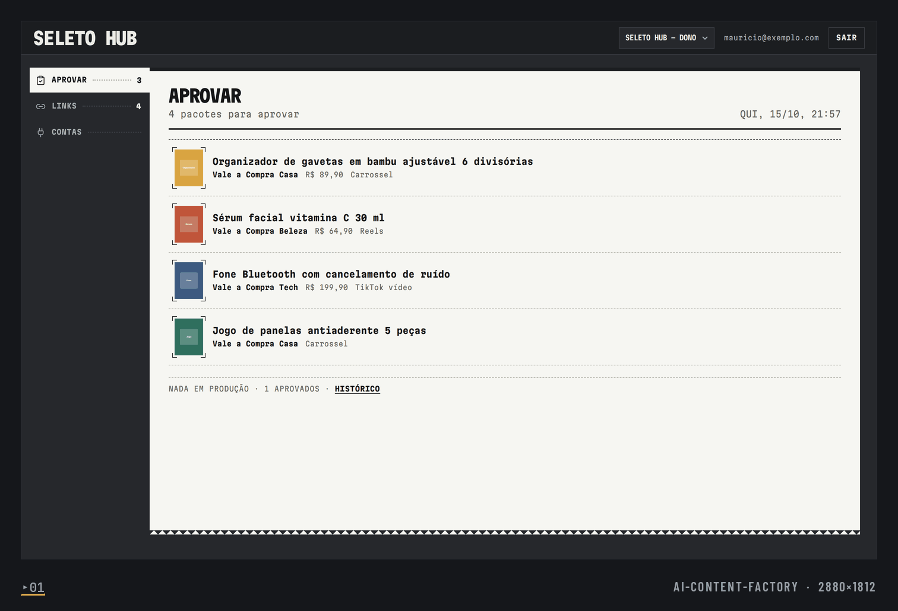
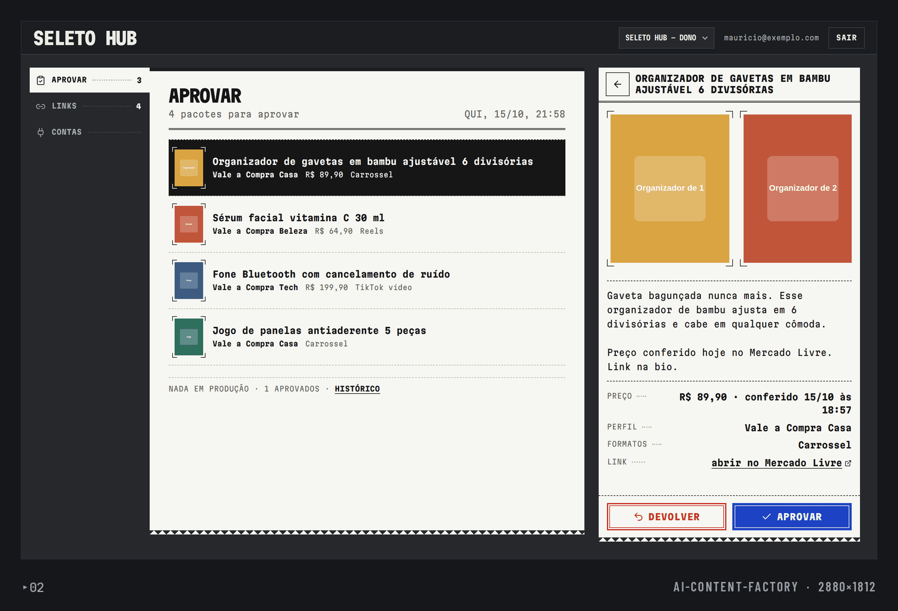
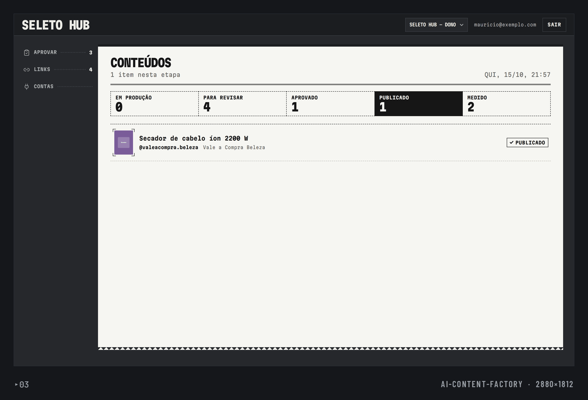
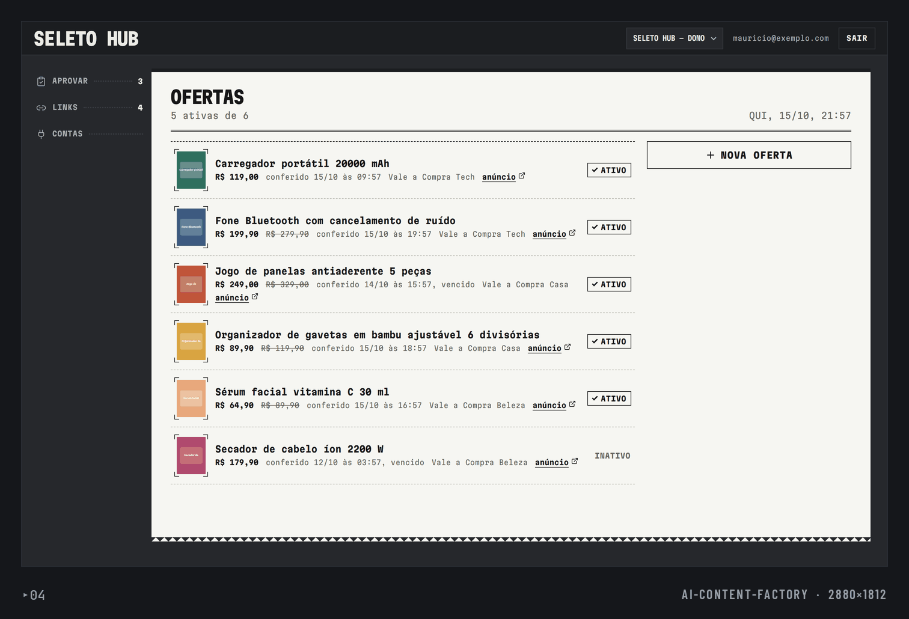
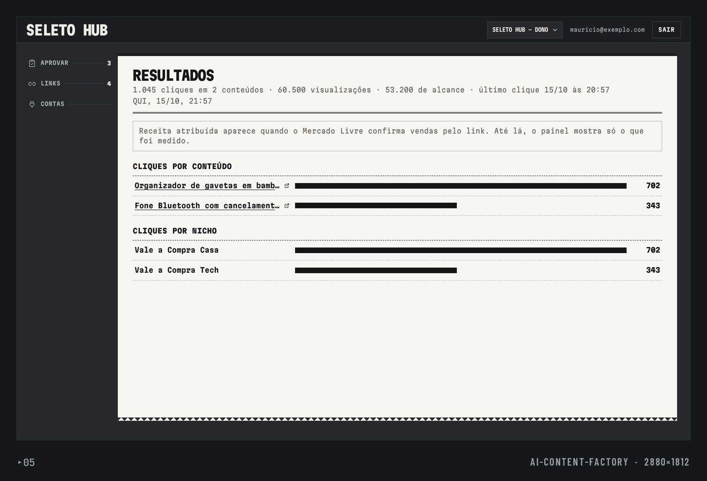
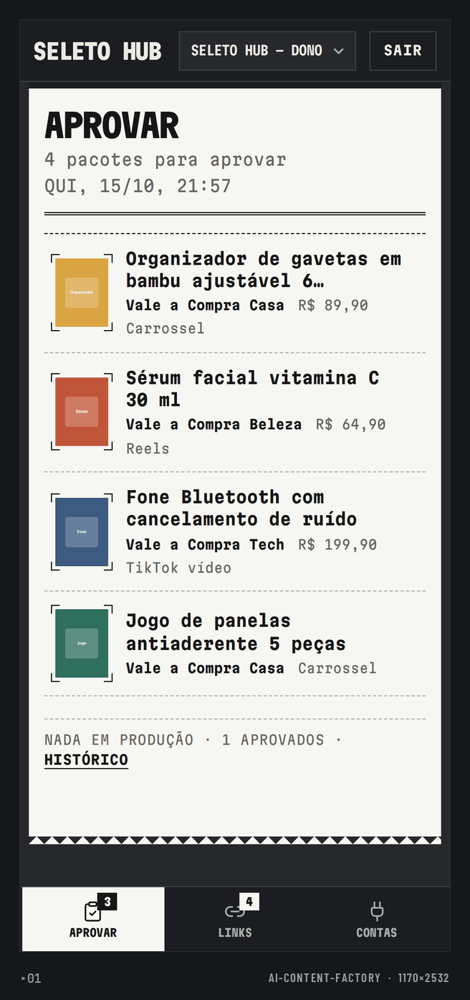
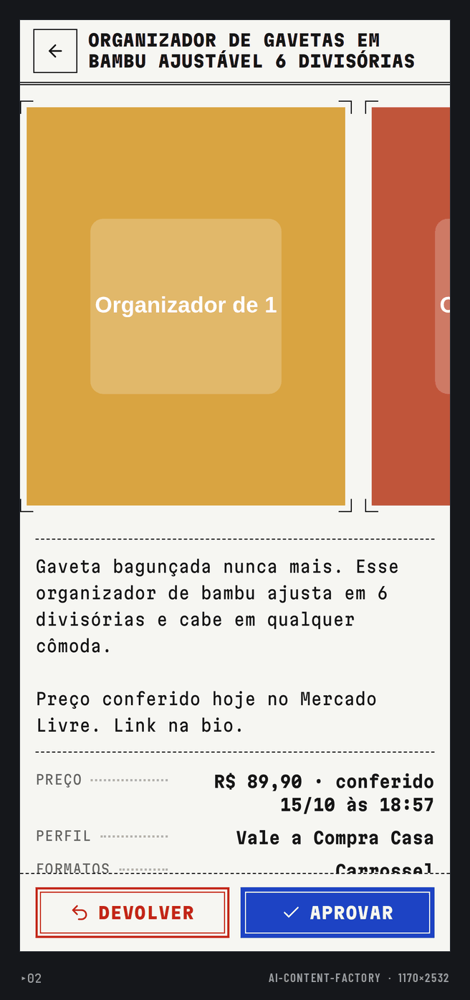
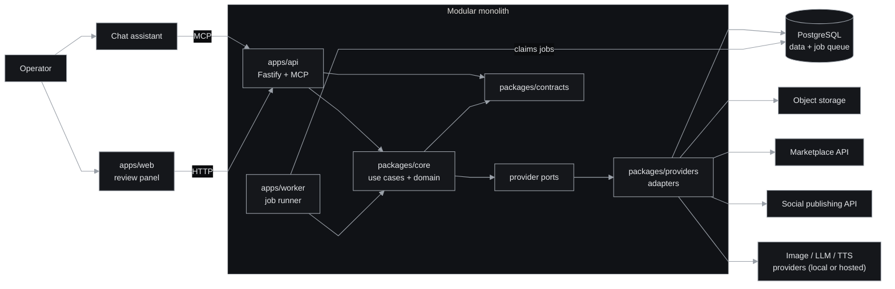
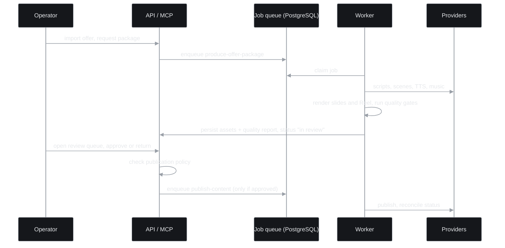
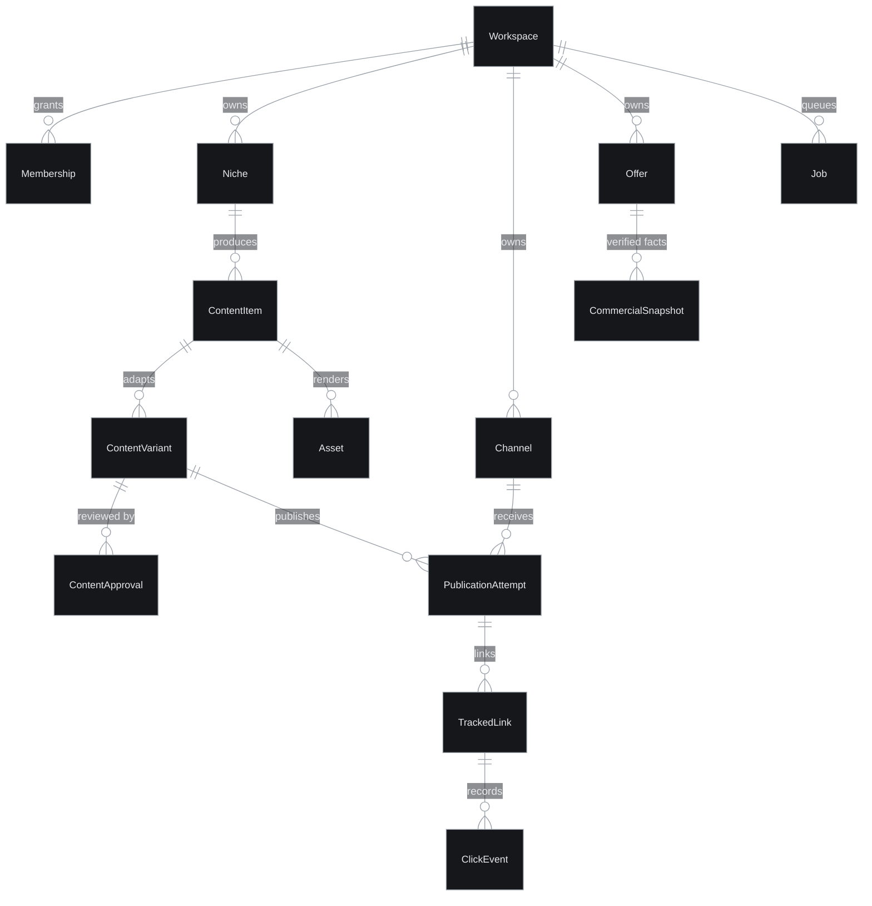

# Affiliate Content Factory

An AI content factory that turns affiliate offers into reviewed social posts: scripts, branded images, narrated Reels, a human review queue and an MCP server to drive it from a chat assistant.

**Status:** Prototype under active development, available for portfolio review. Publishing, spending and approvals are gated by explicit human policy; no usage or performance claims are made.

## What it does

- Imports offers from a marketplace provider and keeps verified commercial facts (price snapshots, evidence) so copy cannot invent numbers (`packages/core/src/offers`).
- Writes scripts and slide decks, validated against evidence and copy-quality gates (`packages/core/src/content`, `creatives`).
- Renders branded slide images with deterministic templates, brand kits and a scene bank (`apps/worker/src/handlers/render-creatives.ts`).
- Produces narrated Reels: local TTS, music, motion, frame review (`render-reel.ts`, `review-frames.ts`).
- Review queue in a web panel: approve or return a package; nothing is published without approval and a publication policy (`apps/web/src/features/panel`).
- Publishing and reconciliation through a provider adapter, with click tracking and attribution (`publishing`, `TrackedLink` in the schema).
- MCP server (100+ tools) over the same use cases as the HTTP API (`apps/api/src/mcp`).
- A bounded "autonomy cycle" that keeps candidate products flowing but never approves, publishes or spends (`packages/core/src/autonomy`, ADR 0013).
- Routing of generation between free, local and hosted providers under a budget (`packages/core/src/generation`).

## Screenshots

Operator panel running against mocked API fixtures with fictitious seed data; product images are solid-colour placeholders.

<table>
  <tr>
    <td width="50%"><br><sub>Approval queue: packages awaiting the operator's decision.</sub></td>
    <td width="50%"><br><sub>Package ticket with slide previews, copy and price; Return or Approve.</sub></td>
  </tr>
  <tr>
    <td width="50%"><br><sub>Content list.</sub></td>
    <td width="50%"><br><sub>Offers desk.</sub></td>
  </tr>
  <tr>
    <td width="50%"><br><sub>Results desk.</sub></td>
    <td></td>
  </tr>
</table>

<table>
  <tr>
    <td width="25%"><br><sub>Approval queue on mobile.</sub></td>
    <td width="25%"><br><sub>Package ticket on mobile.</sub></td>
  </tr>
</table>

## Architecture



- Dependencies point inward: apps, then providers, then core, then contracts. `core` imports no web framework, ORM or vendor SDK.
- PostgreSQL is both the source of truth and the job queue (no Redis); the worker claims jobs with leases.
- Every tenant-owned record is scoped by `workspaceId`; access is denied by default.
- MCP tools are thin wrappers over the same use cases as the HTTP API; each tool declares its risk (read, spend, publish).
- Heavy generation can run on a separate pull-based worker with a scoped token, so no inference endpoint is exposed.

Authoritative documents (not duplicated here):

| Topic | Document |
|---|---|
| Component boundaries, request and job flow, MCP design | [docs/architecture/system-design.md](docs/architecture/system-design.md) |
| Data model | [docs/architecture/data-model.md](docs/architecture/data-model.md) |
| Provider contracts | [docs/architecture/integrations.md](docs/architecture/integrations.md) |
| Creative engine (layers, quality gates) | [docs/creative-engine/architecture.md](docs/creative-engine/architecture.md) |
| Content generation and model evaluation | [docs/content-generation/README.md](docs/content-generation/README.md) |
| Security policy | [SECURITY.md](SECURITY.md) |
| Engineering standards | [docs/engineering/standards.md](docs/engineering/standards.md) |

ADRs in [docs/adr](docs/adr): modular monolith (0001), PostgreSQL as source of truth (0002), provider ports (0003), deterministic creative pipeline (0009), hybrid local AI (0011), home worker API (0012), autonomy cycle (0013), layered creative engine (0014).

### Core flow: offer to reviewed post



Files: `apps/worker/src/handlers/produce-offer-package.ts`, `render-creatives.ts`, `render-reel.ts`, `publish-content.ts`, `apps/api/src/routes/approvals.ts`.

### Data model

43 Prisma models in `packages/providers/prisma/schema.prisma`; the main chain is:



## Key engineering decisions

- Modular monolith with three processes and strict inward dependencies: `docs/adr/0001-modular-monolith.md`.
- Provider ports with replaceable adapters, including fakes for tests: `docs/adr/0003-provider-ports.md`, `packages/providers/src`.
- Deterministic creative pipeline: models produce raw art, code composes and checks the final asset: `docs/adr/0009-deterministic-creative-pipeline.md`.
- Evidence gates reject copy containing numbers without a verified source: `packages/core/src/content`.
- Human approval before any publish or spend, enforced by policy rather than UI: `docs/adr/0013-autonomy-cycle.md`.
- Bounded, idempotent autonomy pass with isolated per-step failures: `packages/core/src/autonomy`.

## Tech stack

TypeScript (strict), pnpm workspaces, Node 24, Fastify 5, MCP SDK, React + Vite + TanStack, Zod, Prisma with PostgreSQL, S3-compatible object storage, Sharp for rendering, Vitest, Biome, Docker Compose for deployment.

## Getting started

Prerequisites: Node 24, pnpm 11, PostgreSQL.

```bash
pnpm install --frozen-lockfile
cp .env.example .env        # placeholders only; fill locally
pnpm db:migrate
pnpm build
pnpm --filter @money-maker/api start     # API + MCP
pnpm --filter @money-maker/worker start  # job runner
```

`.env.example` lists every variable with comments; `pnpm env:validate` checks a configuration. Main groups:

| Names | Purpose |
|---|---|
| `DATABASE_URL`, `DIRECT_URL`, `TEST_DATABASE_URL` | PostgreSQL (the last one must be a disposable database) |
| `AUTH_*`, `SESSION_SECRET`, `SECRET_STORE_MASTER_KEY` | Identity provider and secret encryption |
| `R2_*` | Object storage for media |
| `MERCADO_LIVRE_*`, `CANVA_*`, `POST_FOR_ME_*`, `YOUTUBE_DATA_API_KEY` | Provider credentials |
| `TTS_URL`, `SCENE_DIRECTOR_*`, `IMAGE_GEN_*`, `LOCAL_AI_*` | Optional generation backends |
| `WORKER_PROFILE`, `WORKER_JOBS`, `AUTONOMY_ENABLED` | Worker behavior |

## Testing

About 3,570 tests pass locally across six workspaces (config 23, web 89, core 1,776, providers 535, api 706, worker 436); 102 PostgreSQL integration tests are skipped unless `TEST_DATABASE_URL` is set. `pnpm typecheck` passes.

```bash
pnpm check        # format, lint, typecheck, test, build
```

## Project structure

```text
apps/api         HTTP API, MCP server, auth
apps/web         operator panel and public storefront pages
apps/worker      job handlers, renderers, autonomy loop
packages/core    domain and use cases
packages/contracts  shared schemas and types
packages/providers  adapters: database, storage, marketplace, publishing, LLM, media
deploy/          container and deployment files
docs/            architecture, ADRs, engineering
```

## License

All rights reserved. Source available for portfolio review.
