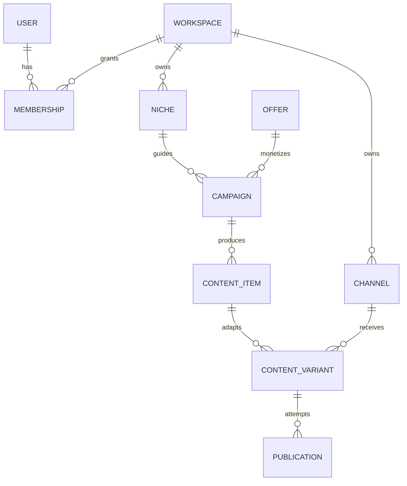

# Core Data Model

**Status:** Accepted at conceptual level. Physical fields are finalized per implementation slice.

## Ownership hierarchy



## Core records

| Record | Purpose | Critical invariant |
|---|---|---|
| User | Human identity | Email normalization and verification are explicit |
| Workspace | Tenant boundary | All owned resources resolve to one workspace |
| Membership | User role in workspace | Unique per user and workspace; revocable |
| Invitation | Controlled onboarding | Token is hashed, scoped, expiring, and single-use |
| Niche | Audience and editorial strategy | `kind` is `affiliate` (offer-led) or `media` (audience-first explainers, no offers), fixed at creation; language and monetization hypothesis are explicit; a public `slug` names the bio storefront page, served by the web app at `/<slug>` (and `/n/<slug>`; the API's `/go/n/<slug>` redirects there): one card per active offer with a published post, newest first, priced only from an active snapshot verified in the last 24 hours, hidden entirely when that snapshot says the listing is unavailable |
| Channel | External destination | Capabilities and connection state are normalized |
| Credential | Reference to encrypted provider secret | Secret value is never returned through APIs |
| Offer | Monetization target | Source, evidence, terms, and destination are traceable |
| Campaign | Objective and experiment context | Has metric and stop condition |
| ContentItem | Canonical editorial intent | Stores only keys from one active offer evidence snapshot and separates facts from creative opinion |
| ContentVariant | Channel/language-specific content | Derives from one canonical item and is validated against one workspace channel, connection, offer snapshot, and ordered asset set; `creativeFeatures` (hook move, angle, proof, urgency) are creative opinion, never facts |
| Asset | Media metadata and provenance | License, checksum, storage key, and owner are retained |
| Approval | Human or policy decision | Actor, policy, decision, and timestamp are immutable |
| Publication | External attempt and state | Idempotency key prevents duplicate side effects; `scheduledAt` holds the job in the queue until then; `publishedAt` is set when the provider confirms |
| ReelRender | One Reel video rendered (ffmpeg, no AI) from an approved or published `instagram_carousel` variant's own slides | Unique per workspace and source content variant; `pending` until the worker renders it, then `ready` with the new video asset or `failed` with a reason |
| TrackedLink | One attributable redirect per variant or publication attempt (`/go/<slug>`) | Https destination with fingerprint; optional existing Mercado Livre label is reusable group metadata, never a publication ID; expired or altered links fall back to the listing URL |
| ClickEvent | One click on a tracked or bio link | Keeps variant and exact publication-attempt IDs when available; stores a salted, daily-rotating visitor hash, never an IP or user agent; crawlers are not recorded |
| ContentPerformance | Lifetime metrics of a published post | Append-only, read 1, 3, 7, and 30 days after publication; empty when the provider returns none |
| Automation | Trigger/action policy | Limits and approval mode are explicit |
| AutomationRun | One execution trace | Inputs, decisions, cost, and result are auditable |
| MetricEvent | Conversion, cost, or revenue (planned: `RevenueEvent`, see S3 spec) | Source and occurrence time are preserved |
| ConversionEvidence | Normalized evidence scope (domain classifier only; persistence awaits a real export) | Exact mapped provider publication reference may resolve to one `PublicationAttempt`; label/account observations remain aggregate |
| AuditEvent | Security-sensitive action | Append-only and free of raw secrets |

### Offer evidence records

An `Offer` belongs to exactly one workspace and starts in `draft`. It keeps
listing and affiliate destinations separate, stores each monetary field as
integer minor units plus an ISO currency, and transitions to `active` only
after a current evidence snapshot verifies seller, availability, and current
price facts. `CommercialSnapshot` and `CommercialFact` records are append-only
history; conflicting, stale, or unverified facts block activation. The initial
Mercado Livre path is manual URL and evidence entry, with no scraping or
marketplace credential stored by this module.

`import_mercado_livre_offer` stores one fact per field Mercado Livre returns:
`seller`, `availability`, `current_price`, and when present `list_price`,
`discount_percent` (calculated, rounded down), `sold_quantity`,
`available_quantity` (both approximate), `free_shipping`, `rating_average`, and
`review_count`. Fact values are strings, numbers, booleans, or money objects.
A newer snapshot may not contradict an older one; fresh data means a new
import, and `check_offer_status` compares the listing with the snapshot
without writing.

Every 6 hours the worker refreshes every `active` offer from its marketplace: it always writes
a brand-new snapshot and makes it the offer's active one, even when nothing changed, so
`verified_at` stays current — except a volatile fact (price, list price, discount,
availability/stock, shipping) may differ from earlier evidence without being a conflict, while an
identity fact (title, seller) changing still is one, and that offer is skipped and logged. A
delisted or out-of-stock listing gets a snapshot recording availability `false` instead; the offer
state does not change, and the storefront hides that offer's card entirely. The audit entry for
the refresh's activation uses the system actor `system:offer-refresh` (`AuditEvent.systemActor`),
not a human `actorUserId`. A provider failure (rate limit, network, missing credentials) skips
only that offer/workspace and never stops the sweep.

## State machines

Content lifecycle:

```text
draft -> ready_for_review -> approved -> scheduled -> published
                       \-> rejected
approved/scheduled -> cancelled
publication failure -> action_required -> retry or cancelled
```

Transitions are application use cases, not arbitrary field updates.

## Money and time

- Store money as integer minor units plus ISO currency, never floating point.
- Store timestamps in UTC and render them in the user's timezone.
- Preserve provider event time and ingestion time separately.
- Never combine gross revenue, commission, refunds, fees, and cost into one ambiguous amount.

## Deletion

User-visible resources use soft deletion only where recovery or references require it. Secrets are revoked and removed from active use immediately. Audit and financial records follow the applicable retention policy and are not silently rewritten.

Content draft transport currently exposes only workspace-scoped metadata creation and
short-lived signed asset upload targets. It does not approve or publish content.

## Explainer storyboards

`VideoStoryboard.renderer` is `slideshow` (each scene references an image asset) or
`stickman_still` (each scene is a `SceneSpec`: purpose, background, rigged actors, props, optional
diagram, overlays, camera). SceneSpec scenes are validated against the media niche's rigged cast
(`Niche.context.characters`) and the script's claims: every number a diagram shows cites a claim.
Stills are composed deterministically from code at preview and render time; nothing is generated
by a model. Script claims carry a `kind` (`verified_fact`, `reasonable_simplification`, `analogy`,
`hypothesis`, `fictional_example`); stored claims without a kind read as verified facts. See
`docs/superpowers/specs/2026-09-29-media-brand-stickman-explainer-design.md`.

`stickman_motion` uses the same SceneSpec scenes, animated frame by frame (sharp + ffmpeg, no
model). Its actors may carry word-anchored `actions` (enter, exit, walk_to, pose, expression,
jump, react, point_at at a prop, overlay or diagram of the same scene, look_at at the same targets or another actor, emote as a named emotion that the motion planner expands into those primitives), stored inside the scenes JSON and validated against the rig and the scene narration.
Rigged characters may carry a Kokoro `voiceId`; a SceneSpec storyboard without an explicit voice
stores the main character's (then the niche's) voice. See
`docs/superpowers/specs/2026-09-30-stickman-motion-and-render-safety-design.md`.

A `stickman_motion` scene may carry `backgroundAssetId`: an image asset whose `metadata.role` is
`explainer_background` (active, with commercial rights) drawn under the stage instead of the
procedural `background`, which stays the fallback. Painted backgrounds are banked per niche,
setting and art style (`metadata.sceneKey` `<nicheId>:explainer:<setting>:<style>:v<n>`, style from
`Niche.context.explainer.style`). An `ambient_loop` asset (`video/mp4`, `metadata.backgroundAssetId`,
`metadata.qa`, `metadata.generation`) plays under the stage in place of its background's still.
Locally generated assets record `metadata.generation` (model, weights licence, tool, seed, prompt,
prompt version); only allowlisted Apache-2.0 models get commercial rights. Rigged characters may
carry a `wardrobe` (hair, top, bottoms, big head) from a closed catalog. The scene director never
proposes `backgroundAssetId`: it is absent from the director's JSON schema and `directScenes`
rejects it.

## Render quality reports

`ReelRender.qualityReport` and `LongFormRender.qualityReport` (JSONB, nullable) hold the
post-render quality gate: version, verdict (`pass`, `warn`, `block`), one entry per check
(container, dimensions, fps, duration, audio stream, loudness, true peak, silence, black, freeze,
render notes) and the measurement time. Null means the render predates the gate. A blocked render
is recorded `failed` with `quality_blocked:<check ids>` and never becomes an asset.
