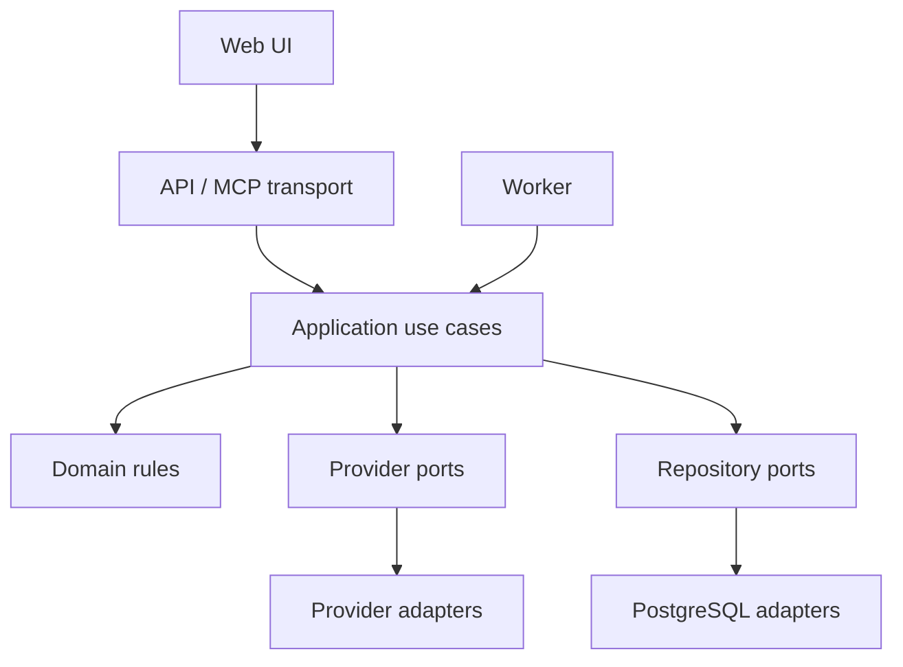

# System Design

**Status:** Accepted

## Architectural style

Money Maker starts as a modular monolith. One codebase contains cohesive business modules; three processes expose them:

- `api`: REST endpoints and MCP tools.
- `web`: the operator dashboard.
- `worker`: durable background jobs.

This gives clear runtime responsibilities without distributing business logic across services.

## Technology baseline

| Concern | Choice | Reason |
|---|---|---|
| Language | TypeScript, strict | One language across web, API, worker, and contracts |
| Package manager | pnpm workspaces | Fast, deterministic monorepo management |
| API and MCP host | Fastify 5 | Small, explicit, schema-friendly server |
| Web | React + Vite + TanStack Query/Router | Fast operator UI with explicit server state |
| Validation | Zod | Shared boundary schemas and useful errors |
| Database | PostgreSQL on Neon | Durable relational source of truth with managed operations |
| Data access | Prisma | Explicit schema, migrations, and familiar TypeScript client |
| Object storage | Cloudflare R2 | S3-compatible media storage without coupling the domain to S3 |
| Jobs | PostgreSQL-backed queue | Avoid Redis until workload proves it is necessary |
| Tests | Vitest + integration tests with real PostgreSQL | Fast unit tests and realistic data-boundary coverage |
| CI | GitHub Actions | Public repository automation close to source |

Versions are pinned during scaffolding and upgraded deliberately.

## Component boundaries

### Core modules

- `identity`: invitations, users, sessions, memberships, and roles.
- `workspaces`: workspace settings and policy defaults.
- `niches`: niche definitions, languages, audiences, and positioning.
- `offers`: affiliate, service, and digital product offers with evidence.
- `channels`: destinations, capabilities, and connection status.
- `content`: canonical items, channel variants, approval, and provenance.
- `publishing`: schedules, publication attempts, and provider reconciliation.
- `assets`: storage metadata, ownership, license, and transformations.
- `automation`: triggers, policies, runs, limits, and pause state.
- `analytics`: clicks, costs, revenue events, attribution, and experiments.
- `audit`: append-only records of sensitive actions.

A module exposes application use cases. Other modules do not query its tables directly.

## Request and job flow

1. Transport authenticates the actor and validates input.
2. The application use case authorizes workspace access.
3. Domain rules decide whether the requested transition is valid.
4. A transaction persists state and, when necessary, enqueues an outbox/job record.
5. The worker claims the job and calls a provider port.
6. Provider results are normalized, persisted, and exposed to the operator.
7. Retryable failures use bounded backoff; permanent failures become actionable states.

## MCP design

MCP is a control surface, not the business layer. Tools are thin wrappers around the same application use cases used by the HTTP API.

Tool properties:

- Narrow, verb-oriented names such as `create_niche`, `draft_content`, and `approve_publication`.
- Workspace context is explicit and authorized server-side.
- Read tools have no hidden side effects.
- Write tools return the changed resource and audit identifier.
- External side effects require an idempotency key and an approval state.
- Tool descriptions state cost, publication, and irreversible effects.

## Multi-tenancy

Every tenant-owned table includes `workspace_id`. Application repository interfaces require workspace context. Composite uniqueness includes `workspace_id` where appropriate. Authorization is tested with two workspaces to prove both allowed and denied access.

PostgreSQL row-level security may be added as defense in depth after the application model is stable; it does not replace application authorization.

## Deployment shape

Initial production needs only:

- One static web deployment.
- One API process.
- One worker process.
- One Neon PostgreSQL database.
- One Cloudflare R2 bucket with workspace-scoped object keys.

Local machines (Mac mini M4, Windows desktop, MacBook Air M1) join only as outbound pull workers: they claim the job names they register, download scoped inputs, upload outputs, and never expose an inference endpoint to the internet. Production inference on the cloud VM host is limited to the Kokoro CPU sidecar. See ADR 0011 and `docs/operations/local-ai.md`.

The worker renders social creatives from versioned slide templates with Sharp, bundled Inter fonts, canonical product cutouts, and workspace/niche/channel Brand Kits. Licensed scene backgrounds come from the Scene Bank; Cloudflare Workers AI through AI Gateway fills the bank within a daily neuron budget, and procedural backgrounds are the fallback. Rendered assets retain their source photo IDs, template versions, renderer version, scene IDs, and Brand Kit hash. The operator approves the finished preview before publication.

The worker turns Reel slide scripts into narrated audio through a `SpeechSynthesizer` port in core; the Kokoro-FastAPI CPU sidecar (`tts` in `deploy/docker-compose.yml`) is its only implementation, reachable only from the worker on the compose network with no host port. The port is the swap point if Kokoro is later replaced by Chatterbox or a paid speech API.

## Evolution triggers

Add infrastructure only when evidence meets a trigger:

- Add Redis when PostgreSQL job contention or latency violates an observed service target.
- Split a service when independent deployment, scaling, security isolation, or ownership is repeatedly blocked.
- Add a second provider when downtime, pricing, capability, or policy creates material business risk.
- Add event streaming only when transactional outbox delivery cannot meet a measured use case.
